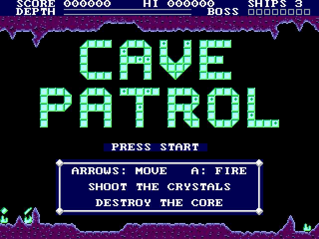
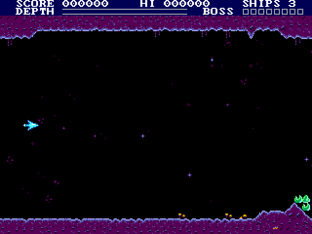
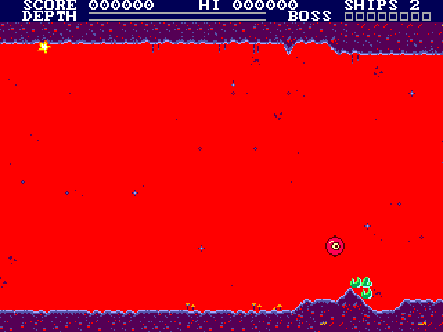
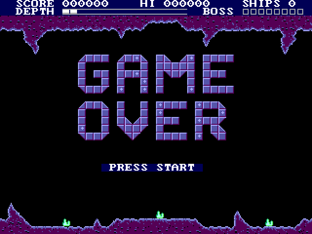

# CAVE PATROL (FPGA, pure Verilog)

A horizontal auto-scrolling cave shooter that runs on a console-style PPU
(picture processing unit), all in plain Verilog: no CPU, no software, no
frame buffer. The PPU is the one from
[fpga-ppu](https://github.com/xHexlabx/fpga-ppu), file for file.

Course project 6 of 2110597 Graphics System Architecture, Chulalongkorn
University.

**Play it:** [open in the VGA Playground](https://vga-playground.com/?repo=https://github.com/xHexlabx/fpga-game-ppu),
then turn on Gamepad mode.



Fly the patrol ship through a 4096-pixel cave. Shoot drones, darts and
turrets; shoot the crystals that block the way; don't touch the rock. At the
end of the cave the camera stops and the CORE, a 32x32 boss, has to be shot
down to clear the cave.

## Controls

In the playground, turn on **Gamepad** mode.

| Key | Action |
| --- | --- |
| Arrows | fly |
| `a` or `b` | fire (hold for auto-fire) |
| `t` (start) or `a` | start a game on the title, GAME OVER or CLEARED screen |

Without Gamepad mode the `ui_in` switches work too. The playground's buttons
are toggles, so each one counts as held while it is on: `ui_in[0..3]` =
up/down/left/right, `ui_in[7]` = fire. On a text screen, flipping `ui_in[7]`
starts a game.

## Rules

- 3 ships. Touching rock, an enemy, an enemy orb or the CORE costs a ship. A
  new ship appears after 1.5 s and blinks while it is invulnerable for 2 s.
- Drone 100, dart 150, turret 200, crystal 50, each hit on the CORE 10,
  destroying the CORE 5000. The hi score is kept until power-off.
- The HUD shows score, hi score, ships, how far into the cave you are, and the
  CORE's health once it appears.

## How it uses the PPU

`ppu.v`, `vga_timing.v`, `chr_rom.v` and `gamepad_pmod_rx.v` are byte-for-byte
the files of [fpga-ppu](https://github.com/xHexlabx/fpga-ppu). This project changes only the cartridge: the game
program (`game_cpu.v`) and its ROM data. The game never draws a pixel; each
frame, in vertical blank, it writes the PPU the way a console CPU would:

| PPU feature | What the game does with it |
| --- | --- |
| Two VRAM pages + split screen | Page 1 holds the HUD (lines 0-15, scroll register A) and the text screens. Page 0 holds the cave (scroll register B). Split line 16 |
| Scroll with wrap | The camera scrolls page 0 by 1 px per frame. The cave is 512 columns long but page 0 is only 64 wide, so each time the camera crosses a tile column the game copies the next level column from cartridge ROM into VRAM, 64 columns ahead of where it gets overwritten |
| VRAM read port | Collision with the cave: the game reads the tiles under the ship's edge points and the shots' tips. Tiles `0x80-0xFF` are rock, `0x70-0x7F` crystal |
| VRAM writes | A bolt that hits a crystal writes an empty tile back over it, so the crystal is gone |
| 64-sprite OAM, 8 per line | Ship in slot 0. The bolts, orbs, enemies and the 4 quarters of the CORE rotate through slots 1-32 one place per frame, so if more than 8 ever share a line they flicker instead of one disappearing |
| H/V flip | Ceiling turrets are floor turrets flipped upside down |
| Palette RAM | Crystals colour-cycle; the CORE flashes white when hit; the backdrop flashes red when the ship blows up |
| Text tiles | Score and bars are written as tiles into the HUD row of page 1 |

### The game program

`game_cpu.v` is a sequencer that runs a fixed list of steps after each
`frame_start`, one small job per clock (about 250 clocks per frame):

```
INPUT -> SCROLL (+ stream a level column) -> PLAYER -> OBJ (16 objects)
      -> BOSS -> SPAWN -> COLL (49 box tests) -> TERR (16 tile tests)
      -> OAM (64 sprites) -> HUD (37 tiles) -> PAL (7 colours) -> REGS
```

Game states: TITLE, PLAY, GAME OVER, CLEARED. Text screens are copied from the
cartridge (`screens.mem`) into page 1 when the state changes.

## Files

| File | What |
| --- | --- |
| `info.yaml` | what the VGA Playground loads |
| `src/game_cpu.v` | the game |
| `src/tt_um_hextex_cavepatrol.v` | Tiny Tapeout / playground top |
| `src/ppu.v`, `src/vga_timing.v`, `src/chr_rom.v`, `src/gamepad_pmod_rx.v` | unchanged from fpga-ppu |
| `src/level.mem` | the cave: 512 columns x 32 rows of map entries |
| `src/spawn.mem` | enemy spawn table |
| `src/screens.mem` | title, GAME OVER, CLEARED and HUD layouts |
| `src/chr_bg.mem`, `src/chr_spr.mem`, `src/palette.mem` | tiles, sprites, colours |
| `scripts/gen_assets.py` | makes all the `.mem` files; all art and the level are original |
| `sim/` | the Verilator play test, see below |

## Simulation

The play test runs the game in Verilator (5.x), the simulator the VGA
Playground uses, fast enough to play a whole game:

```sh
sh sim/run_game_sim.sh          # all scenarios; or: gameover | crystal | pilot | win
```

It drives the Gamepad Pmod the way the playground does and saves frames
read off the Tiny VGA pins as PNGs in `sim/out/`.

| Title | Flying | Crash | Game over |
| --- | --- | --- | --- |
|  |  |  |  |
